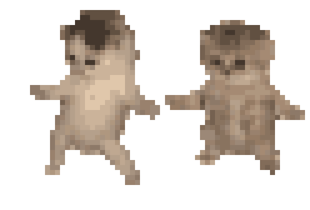
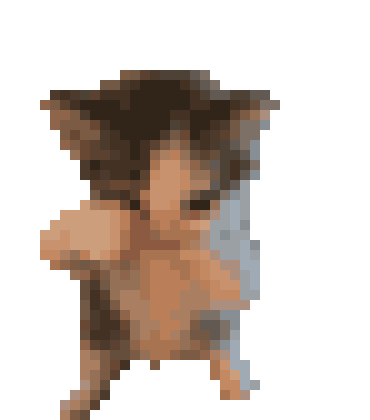

<p align="center">
  
</p>

<h1 align="center">mods</h1>

<p align="center">Small mods for Claude Code.</p>

## pixel-kitty

The kittens, two dancing pixel kittens, replaces the orange working dots in the desktop app. The kittens plays 1 moves in a new order every turn.

<table align="center">
  <tr>
    <td align="center"><br>dance</td>
  </tr>
</table>

To install it, see [pixel-kitty/README.md](pixel-kitty/README.md).

## nosedance

The nosedance cat, a dancing pixel kitten, replaces the orange working dots in the desktop app. It plays 1 move.

<table align="center">
  <tr>
    <td align="center"><br>dance</td>
  </tr>
</table>

To install it, see [nosedance/README.md](nosedance/README.md).

## Install and update

1. Clone the repo into `~/.claude/mods`, so it sits at `~/.claude/mods/endorphin_mods`:

   ```bash
   git clone https://github.com/jparkgit/endorphin_mods.git ~/.claude/mods/endorphin_mods
   ```

2. Make pulls fast-forward only, so an update never creates a merge commit:

   ```bash
   git -C ~/.claude/mods/endorphin_mods config pull.ff only
   ```

3. Add each pet folder you want, such as `~/.claude/mods/endorphin_mods/pixel-kitty`, to `CLAUDE_CODE_PLUGIN_DIRS` as the pet's README describes. Add `~/.claude/mods/endorphin_mods/petmods` too, to get the `/petmods:createpet` and `/petmods:fetchpetmods` skills in every project.
4. To update, run `/petmods:fetchpetmods`, or run `git -C ~/.claude/mods/endorphin_mods pull origin main`. Restart Claude Code afterwards.

Pets are added by the repo owner only. Other users just receive them through `/petmods:fetchpetmods`, so leave the pet folders unedited and skip `/petmods:createpet`. Any local commit stops the fast-forward pull. To suggest a pet, open a pull request.

## Choosing a pet

With several pet mods loaded, each turn shows one of them. Type `/pet kitty`, `/pet nosedance` or `/pet random` in the desktop app to choose for the rest of the session.
